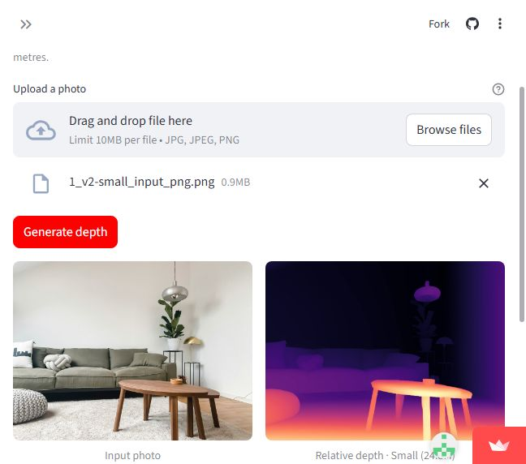

# Stage 5 hosted acceptance

Public app: https://depth-anything-v2-repro.streamlit.app/

Repository: ayyansohail/depth-anything-v2-reproduction. Branch: feat/streamlit-deployment. Entrypoint: app/streamlit_app.py. Python selection: 3.13. Small is the default; Small, Base and Large are enabled.

Status: all guided functional checks passed; exact deployed commit and displayed Python values are awaiting transcription from About the models. The acceptance metadata remains explicit about this outstanding record instead of treating the current branch tip as runtime proof.

## Evidence and observed behaviour

- Colab execution dedcdd309d1282c40f30d7e0a2ed759632a4a9bf passed 24 tests and real CPU Small/Base/Large/Small predictions. Archive and review: ../reviewed/stage5_verification_20261018T202743076758Z/REVIEW.md.
- Independent public-browser Small verification completed prediction, repeated prediction, both downloads and retained-result checks. A screenshot and returned PNGs are under small_initial/.
- The owner repeated checks in Microsoft Edge and supplied colour and normalized 16-bit PNGs for all three models. All have PNG signatures and 1024 x 768 dimensions. Colour downloads are 8-bit RGB; depth downloads are 16-bit grayscale. The depth convention is relative inverse depth, brighter means nearer, not metres. These files are not ground-truth accuracy evidence.
- An intentionally invalid upload was rejected with a readable message; returning to the valid photo produced a result again.
- Switching Base to Small and Large to Small cleared stale outputs and produced correctly labelled Small results afterward.
- The owner confirmed a fresh Edge InPrivate session opened publicly without sign-in, defaulted to Small, and completed a prediction.
- The owner confirmed the requested normal Edge Base and InPrivate Small overlapping requests both completed with correct model labels and no crash. The waiting message itself was not specifically reported. This is a functional session check, not a measurement of simultaneous allocation, host RSS or service capacity.

## Worked example

The supplied living-room photo, originally 4032 x 3024, was downscaled to 1024 x 768. Use the saved processed input at ../reviewed/stage5_verification_20261018T202743076758Z/real_predictions/1_v2-small_input_png.png to reproduce the example without the full-resolution upload.

1. Select one model and upload the image.
2. Click Generate depth and wait for the result beside the input.
3. Download the colour PNG and normalized 16-bit relative inverse-depth PNG.
4. Downloads retain the completed result. Another inference requires Generate depth.

| Model | First owner Edge prediction (s) | Second owner Edge prediction (s) | Evidence |
|---|---:|---:|---|
| Small | 2.46 | 2.40 | edge_small/verification.json |
| Base | 8.03 | 7.97 | edge_base/verification.json |
| Large | 23.30 | 23.45 | edge_large/verification.json |

These are individual observations for one photo, not a benchmark or speed guarantee. Prediction timing excludes model loading, upload and display. The independent Small first-use preparation was 10.94 s and prediction was 2.49 s. Later owner-supplied Cloud logs show Base preparation 9.9517 s, Base predictions 8.0276/7.9723 s, and Small reload preparation 2.1208 s with a 2.6935 s prediction. Large preparation time was not supplied.

## Environment and limitations

Community Cloud logs confirmed Python 3.13.16 and the pinned app-directory dependencies. The host replaced transitive pyarrow 26.0.0 with 24.0.0; this differs from the earlier Colab snapshot and is retained as an environment difference, not rewritten history. An initial uv fetch connection failure recovered through pip and did not prevent the recorded predictions.

Model revisions are pinned to the Stage 4 V2 revisions. One shared ModelManager serializes model loading, inference and encoding, releasing the previous model before a switch. Per-session state retains bytes and metadata. Unit/mocked tests ran in Colab, and actual inference ran in Colab or on Community Cloud; no local Python, package installation, tests, training or inference was performed.

Acceptance applies to the supplied example and guided checks within the configured limits (10 MiB, 16 megapixels, aspect ratio at most 2:1, processed edge at most 1024). It does not promise all-upload feasibility, high-concurrency throughput, continuous uptime or Colab-equivalent speed. Normal Chrome profile loading was problematic for the owner while Edge, Safari and Chrome Incognito worked; the owner chose Edge without changing Chrome settings. No app security settings were weakened for this issue.

Small is Apache-2.0; Base/Large are CC-BY-NC-4.0. Team attribution and repository migration history are retained. Formal report editing remains deferred.

## Source identity

The host displays its current Git revision and Python version under About the models. The build-display change was introduced at e838e27fec6f4c9ec77902f77965287bf6640419. That source commit is not independently established as the actual runtime commit until the displayed values are returned. Later evidence-only commits do not rerun or recreate earlier tests.

